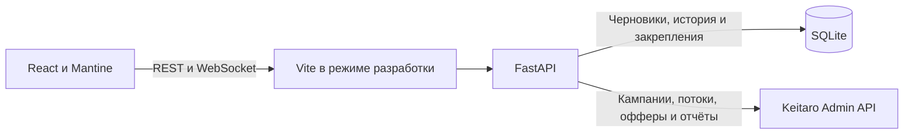

# Архитектура

## Компоненты

React отвечает за список кампаний и интерфейс редактора. FastAPI проверяет входные данные, обращается к Admin API Keitaro, пересчитывает доли и управляет публикацией. SQLAlchemy хранит состояние редактора в SQLite. Alembic управляет схемой БД.

| Файл или модуль | Ответственность |
|---|---|
| `backend/app/main.py` | Создание FastAPI, подключение маршрутов, запуск и закрытие общих HTTP-клиента и сервиса событий |
| `backend/app/api/` | REST, WebSocket, зависимости FastAPI и общие схемы ответов |
| `backend/app/campaigns/creation.py` | Валидация GEO и последовательность создания кампании |
| `backend/app/campaigns/drafts.py` | Версии черновика, правки офферов и распределение долей |
| `backend/app/campaigns/publication.py` | Сверка перед публикацией, запись в Keitaro, история удаления и отмена |
| `backend/app/campaigns/snapshot.py`, `views.py` | Чтение и сравнение конфигурации, формирование состояния редактора |
| `backend/app/campaigns/events.py` | Общий цикл опроса Keitaro и рассылка изменений подписчикам |
| `backend/app/database/` | Подключение к БД, модель SQLAlchemy и хранение состояния редактора |
| `backend/app/keitaro/` | HTTP-клиент Admin API, схемы ответов Keitaro и ошибки связи |
| `backend/app/config.py` | Настройки приложения и загрузка `backend/.env` |
| `frontend/src/AppRouter.tsx` | Маршруты React Router для списка и редактора кампаний |
| `frontend/src/shared/api/` | HTTP-клиент, типы и запросы к API кампаний, офферов и редактора |
| `frontend/src/pages/campaigns/` | Список кампаний и форма создания в `components/` |
| `frontend/src/pages/campaign-editor/` | Страница редактора и компонент потока в `components/` |
| `frontend/src/shared/components/OfferSelect/` | Общий поиск офферов для формы и редактора |
| `frontend/src/shared/hooks/useCampaignEvents.ts` | Подключение WebSocket и переподключение |

У каждого компонента своя папка с `.tsx`, `*.types.ts` и `*.module.css`. Страницы хранят свои файлы в папках страниц, а компоненты конкретной страницы лежат в её `components/`. Модули HTTP и API сгруппированы по назначению в `shared/api/`, а их контракты REST и WebSocket находятся рядом в `*.dto.ts`. Несколько обязательных классов объединяются через `cn(styles.root, styles.compact)`, а классы, зависящие от состояния, вычисляются перед `return` через объект с ключами из CSS-модуля.

## Запросы к Keitaro

Все пути в таблице относительны к `/admin_api/v1/`. FastAPI использует один асинхронный HTTP-клиент на процесс. Он добавляет ключ и проверяет структуру ответа перед передачей данных в сервис.

| Операция приложения | Маршруты Keitaro |
|---|---|
| Список кампаний | `GET /campaigns` с `limit` и `offset` |
| Поиск и проверка оффера | `GET /offers`, `GET /offers/{id}` |
| Настройки новой кампании | `GET /domains`, `GET /groups?type=campaigns`, `GET /traffic_sources` |
| Создание и включение | `POST /campaigns`, `POST /streams`, `POST /campaigns/{id}/enable` |
| Получение состояния редактора | `GET /campaigns/{id}`, `GET /campaigns/{id}/streams`, каталог офферов и отчёт `POST /report/build` |
| Публикация изменённого потока | `PUT /streams/{id}` и проверочное чтение `GET /streams/{id}` |
| Фоновая сверка | `GET /campaigns/{id}`, `GET /campaigns/{id}/streams` |

## Создание кампании

1. FastAPI проверяет название, положительный ID оффера и двухбуквенные коды стран. GEO приводится к верхнему регистру, повторяющиеся коды устраняются, а значения сверяются со справочником ISO через `pycountry`.
2. Клиент проверяет, что оффер активен. Затем параллельно читает домены, группы кампаний и источники. Если явно задан домен, используется единственный доступный активный домен с таким именем. При пустой настройке выбирается единственный активный домен, видимый ключу. Группа и активный источник выбираются по настроенным именам.
3. Создаётся отключённая кампания с позицией как типом ротации, уникальным алиасом и ID домена, группы и источника.
4. Создаётся активный поток `regular` на первой позиции учебного стенда. Для других хостов используется `forced`. Схема `redirect`, действие `http`, ссылка Google и фильтр `country` в режиме `accept`.
5. Создаётся активный поток `default` на второй позиции. Схема `landings` и один активный оффер с долей `100%`. Для обоих потоков включён сбор кликов.
6. Приложение перечитывает кампанию и потоки. Проверяет их состояние, приоритет, привязки, GEO и оффер. После проверки вызывает включение и возвращает ссылки на кампанию и на админку.

Запросы записи идут последовательно. При сбое настройки приложение возвращает ID кампании, если он известен, статус и этап ошибки. При таймауте создания алиас помогает найти операцию в Keitaro. При ошибке включения сервис перечитывает кампанию. Подтверждённый активный статус достаточен для успешного ответа.

## Модель редактора

### Состояние Keitaro и локальная БД

Keitaro хранит опубликованные настройки и статистику. В таблице SQLite `campaign_editor_state` не более одной строки на кампанию.

| Колонка | Значение |
|---|---|
| `campaign_id` | ID кампании Keitaro и первичный ключ |
| `version` | Версия локального состояния редактора. До первой записи равна `0` |
| `draft` | JSON черновика. Содержит исходную версию Keitaro и данные изменённых потоков |
| `removed` | JSON с ID офферов, удалённых при подтверждённой публикации. Ключи — ID потоков |
| `pins` | JSON с закреплёнными долями. Хранит по каждому потоку соответствие ID оффера и целой доли |

После публикации или отмены поле `draft` очищается. Строка остаётся, чтобы сохранить историю, закрепления и версию. В ответе редактора для каждого потока объединяются текущий список Keitaro, изменения черновика и удалённые офферы из истории. Имена приходят из каталога офферов. Если каталог недоступен или в нём нет конкретного оффера, интерфейс показывает его ID.

Редактирование доступно для потоков со схемой `landings`, включая отключённые потоки. Потоки с прямым редиректом отображаются для контекста. Клики запрашиваются отчётом `report/build` с интервалом `today`, фильтром по ID кампании и группировкой по ID потока. Отсутствие строки потока в успешном отчёте отображается как `0`. Ошибка отчёта отображается как «нет данных».

### Доли и автосохранение

Вся запись черновика проходит через `PATCH`. Сервис принимает одно действие, проверяет присланную локальную версию и сохраняет черновик с пересчитанными долями. Устаревшая версия даёт `409`, после чего интерфейс перечитывает результат другого окна.

Для активных офферов из `100%` вычитается сумма закреплённых долей. Остаток делится поровну между активными офферами без закрепления. Целочисленный остаток распределяется по одному процентному пункту в порядке офферов в черновике. Например, `75%` на двух офферах дают `38%` и `37%`. Операция отклоняется, если сумма закреплений превышает `100%` или если все активные доли закреплены и составляют в сумме меньше `100%`. При отсутствии активных офферов распределение пропускается.

Закреплённая доля хранится в SQLite. При загрузке опубликованного потока закрепление применяется, когда оффер активен и его доля в Keitaro совпадает с сохранённой. Удаление оффера освобождает его долю. Возврат добавляет оффер в активный список с перерасчётом.

### Версия Keitaro и публикация

`remote_revision` — SHA-256 от конфигурации кампании и потоков, которую использует редактор. В неё входят настройки маршрутизации и состав офферов с долями и состояниями. Метрики кликов и локальные изменения черновика вычисляются отдельно. Эта версия отвечает на вопрос об изменении Keitaro, локальная `version` — об изменении черновика или его метаданных.

Перед публикацией FastAPI перечитывает конфигурацию Keitaro. Если версия отличается от сохранённой в черновике, API возвращает `409 external_change`. Пользователь открывает текущие настройки и при необходимости подтверждает перезапись. Подтверждение относится к конкретной версии. Если Keitaro изменился ещё раз, требуется сверка с новой версией.

Для каждого изменённого потока сервис сверяет его схему и принадлежность к кампании, вычисляет список удаляемых ID и передаёт в Keitaro только поле `offers`. Пустой поток отправляется как `{"offers":[]}`. После записи отдельное чтение потока проверяет состав, состояния и доли. Далее сервис сохраняет историю и закрепления для подтверждённого потока и закрывает его часть черновика.

При публикации нескольких потоков Keitaro принимает отдельный запрос на каждый поток. Если один из них отклонён, подтверждённые потоки сохраняются, а оставшиеся части черновика доступны для повторной публикации. При неизвестном результате запроса сервис пытается перечитать поток перед тем, как считать шаг успешным. SQLite сохраняет кандидатов на удаление до сетевого запроса. Это позволяет восстановить ожидаемую историю, если результат выяснится при следующей попытке.

Если оффер добавили прямо в Keitaro после открытия черновика, редактор показывает его фактическую долю и сообщает, что публикация уберёт его из изменённого потока. Пользователь может включить его в черновик. После подтверждённой перезаписи удалённый оффер доступен для возврата из истории.

## WebSocket и опрос

В каждой открытой вкладке редактора поднимается WebSocket. FastAPI объединяет соединения по ID кампании. Первый подписчик запускает проверку, последующие используют тот же цикл и сразу получают последнюю известную версию, когда она есть. Каждые 15 секунд цикл запрашивает кампанию и потоки. Опрос прекращается вместе с последней подпиской.

При изменении версии FastAPI рассылает короткое событие. Фронтенд перечитывает агрегированное состояние через REST и показывает предупреждение, если на момент изменения был черновик. Во время сохранения или публикации фоновое чтение откладывается, чтобы предыдущий ответ не перекрыл результат действия. При переподключении фронтенд перечитывает состояние после первого события.

Список кампаний подписывается на текущую страницу. Вкладки с одинаковыми `offset` и `limit` делят один опрос. Когда меняется набор, порядок, название или статус кампаний на странице либо доступность следующей страницы, фронтенд перечитывает список через REST без сброса пагинации.

Подписки и блокировки операций хранятся в памяти процесса FastAPI. Локальный запуск из README использует один процесс приложения. SQLite хранит состояние редактора между перезапусками. WebSocket-подписки восстанавливаются браузером.

На учебном стенде `keitaro-for-tests.etolegko.com` FastAPI пропускает запрос отчёта и возвращает `clicks_today: null`. После создания фронтенд показывает ссылки на редактор и карточку кампании в админке стенда.

[Документация тестового стенда](https://keitaro-for-tests.etolegko.com/admin/#!/docs/) · [Справочник Keitaro Admin API](https://admin-api.docs.keitaro.io/)
